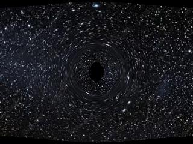

# Kerr Black Hole Lensing

Interactive gravitational lensing around a spinning (Kerr) black hole, rendered in the browser.

**[▶ Live demo](https://arhanthkurli.github.io/Black-Hole-Lensing-Project/)** · **[📄 Full report](https://github.com/arhanthkurli/Black-Hole-Lensing-Project/blob/master/Black_Hole_Simulation_Report.pdf)**

Null geodesics are integrated offline in Python (SymPy, SciPy) using Kerr-Schild coordinates, then baked into a precomputed warp map. A WebGL shader reads that map to distort the background image in real time.

The full report covers the physics, the development phases, and the design decisions behind the pipeline.
